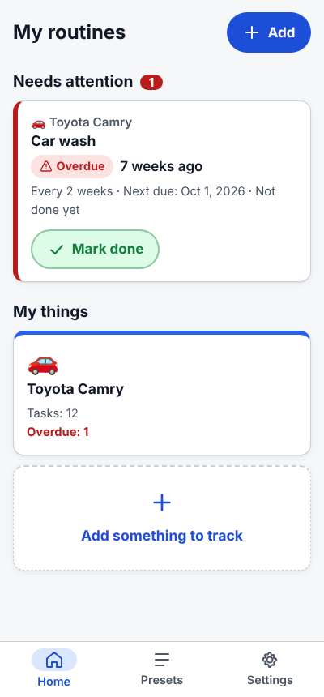
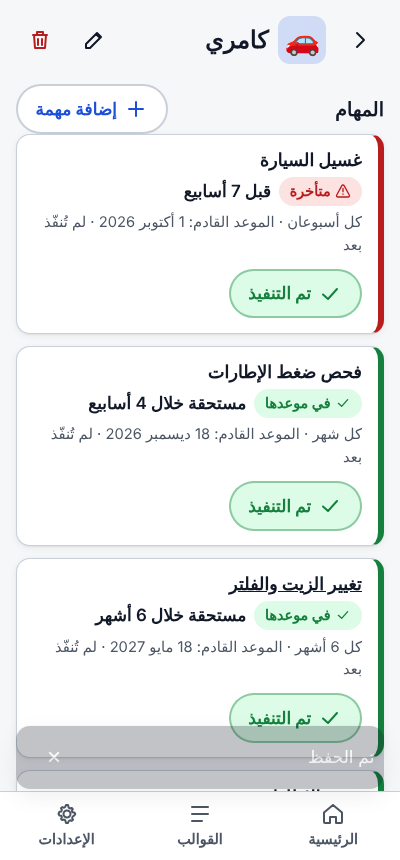

# عناية · Inaya

**Inaya (عناية) means "care".** Take care of the things you care about.

Inaya is a simple, accessible app for keeping track of recurring tasks — car maintenance, gardening, home upkeep, health appointments, pets, bills, or anything else you define yourself.
It works as a **website** and as an **Android app** (built with React + Capacitor), in **Arabic and English** (it follows the device language automatically).

«عناية» تطبيق بسيط وسهل الاستخدام لمتابعة المهام الدورية — صيانة السيارة، العناية بالحديقة، صيانة المنزل، المواعيد الطبية، الحيوانات الأليفة، الفواتير، أو أي شيء تحدده بنفسك.
يعمل **كموقع ويب** و**كتطبيق أندرويد**، **بالعربية والإنجليزية** (يتبع لغة الجهاز تلقائيًا).

| English | العربية |
| --- | --- |
|  |  |

## Get the app · تحميل التطبيق

- **Website:** https://azzamalshaye.github.io/inaya/
- **Android APK:** open the [latest release](https://github.com/AzzamAlshaye/inaya/releases/tag/latest), download `Inaya-debug.apk` on the phone and open it. Android will ask you to allow installing from this source the first time.
- **الموقع:** https://azzamalshaye.github.io/inaya/
- **تطبيق أندرويد:** افتح [آخر إصدار](https://github.com/AzzamAlshaye/inaya/releases/tag/latest) من الجوال، حمّل ملف `Inaya-debug.apk` وافتحه. سيطلب أندرويد السماح بالتثبيت من هذا المصدر في المرة الأولى.

## Features · المزايا

- **Presets** for Car, Garden, Home, Health, Pet, Bills, plus an empty Custom preset. Choosing *Car* gives you oil change, tire rotation, brakes, filters, battery, registration, insurance and more; *Garden* gives you watering, fertilizing, soil care, pruning, weeding, etc.
- **Fully customizable:** rename things, change icons and colors, add/remove/edit tasks and their intervals (days, weeks, months, years). The presets themselves can be edited, and you can create your own.
- **Start dates, past or future:** when adding something, set when tracking starts (e.g. the day you bought the car, or next month for a new garden) and tick **Done before** on any task to enter when it was last done. New tasks ask *"Has this been done before?"* — *Not yet, start from a date* or *Yes, last done on…* — and preview the next due date.
- **One-tap "Mark done"** with optional date, note (e.g. odometer reading) and cost. The next due date is calculated automatically. Every action can be undone.
- **Home dashboard** shows what is overdue, due today and due soon across everything you track.
- **History and total cost** for each task.
- **Reminders** (Android): a notification on the day a task is due, plus a daily nudge when something is overdue. You choose the time.
- **Move to another phone by QR code:** Settings → *Move to another phone*. One phone shows a QR code (large data is split into a few codes that cycle automatically) and the other scans it with the camera. You can also copy/share a text code (e.g. over WhatsApp) and paste it on the other phone. Nothing is uploaded: the data travels inside the code.
- **Backup:** export/import all data as a JSON file. Data stays on the device; there are no accounts and no servers.
- **Arabic & English:** automatic from the device language, can be changed in Settings. Full right-to-left layout.

### Accessibility · سهولة الاستخدام

- Large touch targets (at least 48 px), big readable text, and a **text size** setting (normal / large / extra large) on top of the system font size.
- **High contrast** mode, **dark mode**, and **reduce motion** (also follows the system settings).
- Status is never shown by color alone: every status has an icon and a text label.
- Semantic HTML, labeled form controls, a skip link, focus moves to the page heading on navigation, native modal dialogs with focus trapping, and announcements for screen readers (TalkBack / VoiceOver / NVDA).
- Android back button closes dialogs and navigates back.

## Development · التطوير

Requirements: Node.js 22+. For Android: JDK 21 and Android Studio (Android SDK 36).

```bash
npm install
```

```bash
npm run dev          # web dev server
```

```bash
npm test             # unit tests
```

```bash
npm run e2e          # end-to-end, accessibility (axe), RTL and QR camera tests
```

```bash
npm run build        # production web build in dist/
```

```bash
npm run android      # build, sync into android/ and open Android Studio
```

To build an APK from the command line after `npm run sync`:

```bash
cd android && ./gradlew assembleDebug
```

### Project structure

```
src/
  App.tsx              routing, language/theme, Android back button & reminders
  types.ts             data model
  data/presets.ts      built-in presets (car, garden, home, …)
  i18n/                English & Arabic translations + formatting helpers
  state/store.tsx      app state with persistence (Capacitor Preferences)
  lib/                 dates, notifications, backup, storage
  components/          layout, dialogs, toasts, task card, pickers
  pages/               Home, Add/Edit item, Item, Task, Presets, Settings
android/               Capacitor Android project
.github/workflows/     CI: web deploy to GitHub Pages, Android APK build
```

Adding a language: copy `src/i18n/en.ts` to a new file, translate the values, and register it in `src/i18n/index.tsx`.

## Continuous delivery

- **`web.yml`** — on every push to `main`: type-check, test, build and deploy to GitHub Pages.
- **`android.yml`** — on every push to `main`: build the APK and publish it on the `latest` pre-release. Pushing a tag like `v1.1.0` creates a versioned release.

### Optional: signed release builds (for Google Play)

Create a keystore once:

```bash
keytool -genkey -v -keystore release.keystore -alias routine -keyalg RSA -keysize 2048 -validity 10000
```

Then add these repository secrets (Settings → Secrets and variables → Actions): `ANDROID_KEYSTORE_BASE64` (output of `base64 -w0 release.keystore`), `ANDROID_KEYSTORE_PASSWORD`, `ANDROID_KEY_ALIAS`, `ANDROID_KEY_PASSWORD`. The workflow will then also produce a signed `Inaya.apk` and a `Inaya.aab` for the Play Store. Keep the keystore safe — you need the same one for every update.

## License

MIT
